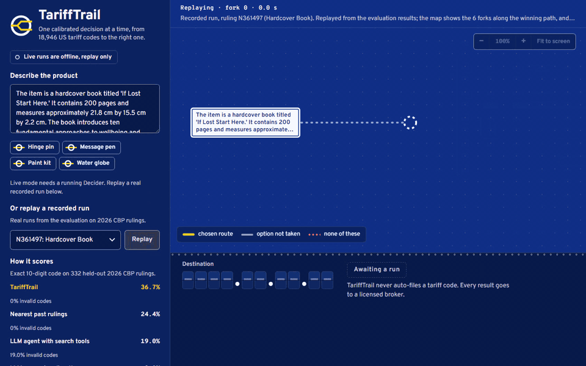
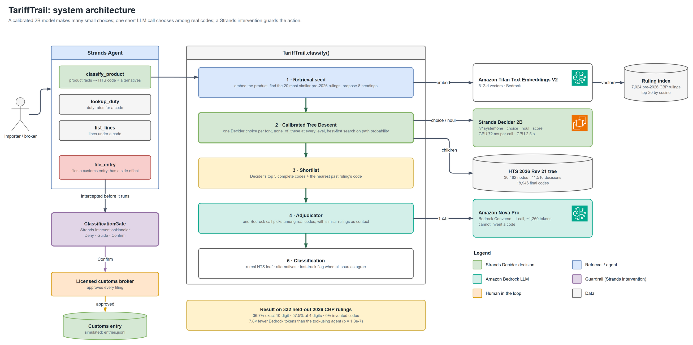
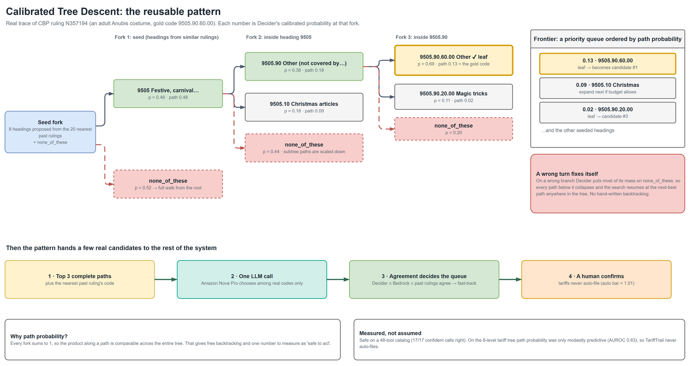
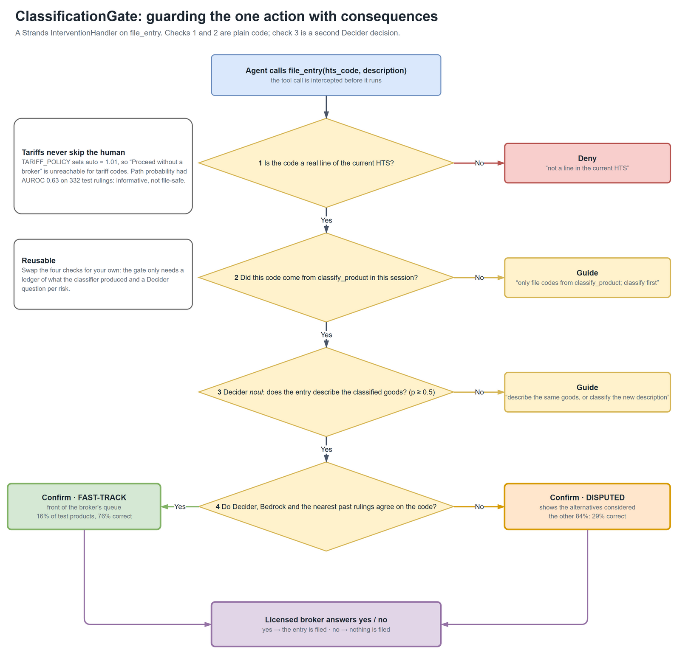
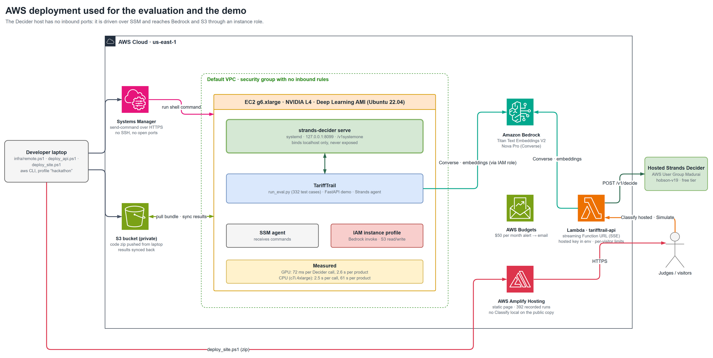
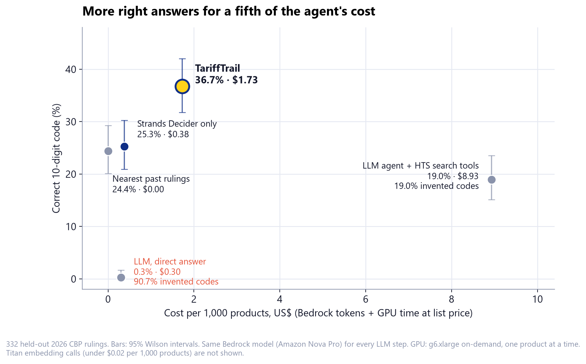
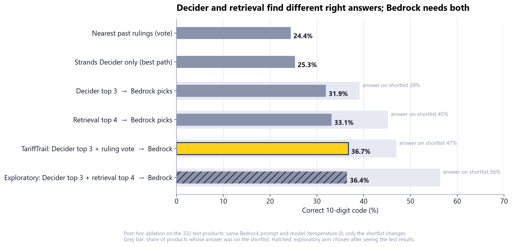
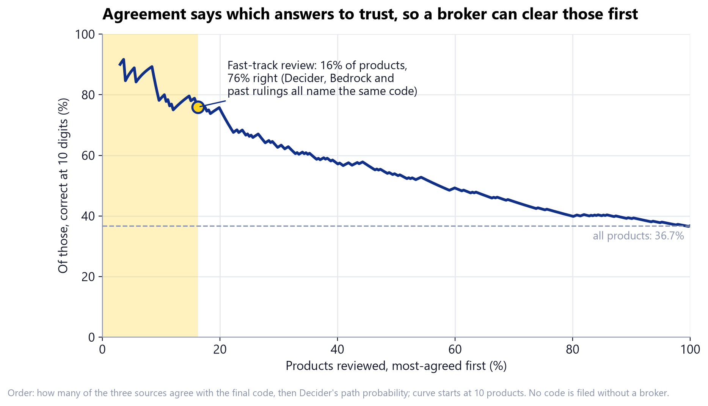

<div align="center">

# TariffTrail

**Classify any product into its 10-digit US tariff code with a 2B-parameter model that knows when it doesn't know.**

An agent that walks the official US tariff tree with **Strands Decider 2B**, then spends one short
Amazon Bedrock call choosing among *real* codes. It cannot invent a code, and it never files one without a human.

[](LICENSE)
[](pyproject.toml)
[](https://github.com/mahanteshimath/AWS-Strands-Decider-Hackathon/actions/workflows/ci.yml)
[](PATTERN.md)
[](tariff_trail/adjudicator.py)
[](https://colab.research.google.com/github/mahanteshimath/AWS-Strands-Decider-Hackathon/blob/main/notebooks/try_tarifftrail.ipynb)
[](#hackathon)

**[▶ Video (2:59)](https://youtu.be/aU4kPYgsOcY)** ·
**[AWS Builder Center article](https://builder.aws.com/project/3L03iMVxl794WGYKsPQOUPkjtQ7/tarifftrail-strands-decider-2b-walks-the-us-tariff-tree-so-the-agent-never-invents-a-customs-code)** ·
**[Live demo](https://main.d3o5ktn9yc15oj.amplifyapp.com/)** ·
**[Run it on a free GPU](https://colab.research.google.com/github/mahanteshimath/AWS-Strands-Decider-Hackathon/blob/main/notebooks/try_tarifftrail.ipynb)** ·
**[The reusable pattern](PATTERN.md)** ·
**[Architecture](#architecture)** ·
**[Results](#results)** ·
**[Quickstart](#quickstart)**

<a href="https://main.d3o5ktn9yc15oj.amplifyapp.com/#run=N361497"></a>

<sub>A real recorded run (CBP ruling N361497, a hardcover book). Each stop on the route map is one Decider call;
every branch is labelled with its probability at that fork. The yellow line is the chosen route and each dotted red
branch is <code>none_of_these</code>. It ends on <code>4901.99.00.70</code>, CBP's own answer, with Decider, Bedrock and past
rulings in agreement. <a href="https://main.d3o5ktn9yc15oj.amplifyapp.com/#run=N361497">Replay this run</a>, or any
of 392 others, in the hosted demo.</sub>

<a href="https://youtu.be/aU4kPYgsOcY"></a><br>
<sub>▶ The 3-minute video: the problem, the pattern, a live run and the results.</sub>

</div>

---

## Why you might care

|  |  |
|---|---|
| **A hard, real problem** | Since US *de minimis* was suspended (29 Aug 2025), every import needs a 10-digit HTS code, even a $20 parcel. The schedule has **18,946 final codes**. |
| **LLMs are bad at it** | Asked directly, Amazon Nova Pro got **0.3%** right and **90.7%** of its answers were codes that do not exist. |
| **Agents loop** | A Strands agent with HTS search tools got 19.0% at ~9,800 tokens a product; one uncapped run made 201 tool calls and burned 19.6 M tokens on a single item. |
| **This works better, cheaper, safer** | **36.7%** exact 10-digit (CI 31.7–42.1), **0%** invented codes, **$1.73 per 1,000 products** against the agent's $8.93, and a human confirms every filing. |
| **The idea is reusable** | The tariff tree is just one tree. [`tree_descent.py`](tariff_trail/tree_descent.py) is a single standard-library file you can point at any decision tree (tools, runbooks, ticket routing, ICD codes), and [`strands_kit.py`](tariff_trail/strands_kit.py) wires it into any Strands agent behind a gate. |

## Contents

[How it works](#how-it-works) ·
[Architecture](#architecture) ·
[Results](#results) ·
[Quickstart](#quickstart) ·
[Use the pattern in your project](#use-the-pattern-in-your-project) ·
[Reproduce the evaluation](#reproduce-the-evaluation) ·
[Repository map](#repository-map) ·
[Limitations](#limitations) ·
[Ideas and roadmap](#ideas-and-roadmap) ·
[FAQ](#faq) ·
[Contributing](#contributing) ·
[Citing](#citing) ·
[Hackathon](#hackathon)

## How it works

```
product facts ─► Titan embeddings: 8 candidate headings from the 20 most similar past CBP rulings
                 │
                 ▼
       Strands Decider 2B: one calibrated choice per fork, "none of these" at every level,
       best-first search on path probability (the product of Decider's probabilities)
                 │
                 ▼
       one Bedrock call picks among Decider's top 3 complete codes + the nearest ruling's code
                 │
                 ▼
       Strands agent: file_entry is guarded by ClassificationGate (an InterventionHandler)
       Deny invented codes · Guide unclassified ones · Confirm every filing with a licensed broker
```

- **It cannot invent a code.** Every answer is a leaf of the official 2026 HTS (Revision 21).
- **It knows its limits.** Decider's confidence was not reliable enough to file tariff codes unattended
  (path-probability AUROC 0.63), so *every* filing goes to a broker. Agreement between Decider, Bedrock and
  past rulings moves the easy 16% of cases to the front of the queue: **76% of those are right, vs 29% of the rest.**
- **It is cheap.** At most one short Bedrock call per product, instead of an agent loop.
- **It is honest about uncertainty.** Every fork offers `none_of_these`. A wrong turn collapses the probability of everything
  below it, and the search resumes at the next-best path anywhere in the tree, with no hand-written backtracking.

## Architecture

All diagrams are editable [draw.io](https://www.drawio.com) files: open any `docs/architecture/*.drawio` (or the
`.drawio.png`, which embeds its own source) in draw.io. Rebuild them with
[`docs/architecture/build_diagrams.py`](docs/architecture/build_diagrams.py).

### System overview



### Calibrated Tree Descent (the reusable pattern)



The numbers are from the real recorded run of ruling N357194, an adult Anubis costume whose gold code is `9505.90.60.00`.

### ClassificationGate (guarding the action)



### AWS deployment



## Results

Everything here comes from **real 2026 CBP rulings** and is reproducible with the scripts in [`eval/`](eval/).
Method and frozen choices: [`research/PREREGISTRATION.md`](research/PREREGISTRATION.md). Full tables, review tiers,
calibration and significance tests: [`eval/RESULTS.md`](eval/RESULTS.md).

Test split: **332 held-out 2026 CBP rulings**, run once with the frozen configuration.

| System | 4-digit | **10-digit** (95% CI) | Invented codes | Bedrock tokens / product |
|---|---|---|---|---|
| LLM, direct answer (Nova Pro) | 31.9% | 0.3% (0.1–1.7) | 90.7% | 241 |
| LLM agent + HTS search tools (Strands, Nova Pro, capped) | 39.5% | 19.0% (15.1–23.5) | 19.0% | 9,789 |
| Nearest past ruling (retrieval only) | 38.0% | 24.4% (20.1–29.3) | 0% | 0 |
| Strands Decider only (retrieval-seeded, no LLM) | 46.7% | 25.3% | 0% | 0 |
| **TariffTrail** | **57.5%** | **36.7% (31.7–42.1)** | **0%** | **1,258** |

TariffTrail vs the LLM agent on the same rulings: 92 products only TariffTrail got right, 33 only the agent got right
(exact McNemar p = 1.3 × 10⁻⁷), with 7.8× fewer Bedrock tokens. For scale, the ATLAS benchmark
([arXiv 2509.18400](https://arxiv.org/abs/2509.18400)) reports 25% at 10 digits for GPT-5-Thinking on a different HTS test set.



**Cost per 1,000 products** at us-east-1 list price: TariffTrail **$1.73** ($1.12 of Bedrock tokens plus $0.60 of
g6.xlarge time, one product at a time), the LLM agent **$8.93**. Breakdown in
[`eval/RESULTS.md`](eval/RESULTS.md#cost-per-1000-products).

### What each part contributes

A post-hoc ablation on the same 332 products keeps every recorded Decider search and the same Bedrock prompt, and
changes only the shortlist Bedrock picks from ([`eval/ABLATION.md`](eval/ABLATION.md)):



- **Neither source is enough alone.** Decider's top 3 gives 31.9%; retrieval's top 4 gives 33.1%; together, 36.7%.
- **Decider wins the heading.** Against the best design without Decider (retrieval + the same Bedrock pick),
  TariffTrail is ahead at 4 digits (57.5% vs 51.2%, p = 0.015). At 10 digits its lead (36.7% vs 33.1%, p = 0.2) is
  within noise; re-running the frozen step alone moves accuracy by a point.
- **Decider reaches codes retrieval cannot.** 22% of the test products have a code that none of the 7,024 indexed
  rulings (Oct 2021 to Dec 2025) uses. Retrieval can never propose those; the tree walk had 16 of them in its top 3 and
  TariffTrail got 13 right.
- **The next lever is the final pick.** A wider shortlist holds the answer 56% of the time, yet Bedrock's pick stays
  at 36%. A post-hoc probe, declared before it ran on test, adds one Bedrock call that reads the whole outline of the
  chosen heading and re-picks the 10-digit line: **36.7% to 43.7%** with Kimi K2.5 (+34 / -11, p = 0.0008), 39.2% with
  Nova Pro (not significant). Not in the app until it is confirmed on fresh rulings
  ([`eval/HEADING_REFINE.md`](eval/HEADING_REFINE.md)).

### Which answers to trust



When Decider, Bedrock and past rulings all name the same code (16% of products), it is right 76% of the time,
against 29% for the rest. TariffTrail uses that to order the broker's queue, never to skip the broker.

**Latency.** The frozen run used a CPU host: 2.5 s per Decider call, 61 s per product. A replication of the same 332
products on a g6.xlarge GPU (NVIDIA L4) measured **72 ms per Decider call and 2.6 s per product (p50), 3.3 s (p95)**,
with accuracy unchanged within noise (37.4% vs 36.7%). The GPU run is a replication, not the frozen headline; details in
[`eval/RESULTS.md`](eval/RESULTS.md#gpu-replication-and-latency-added-after-the-quota-was-approved).

**A second domain with the same pattern code.** Routing requests to 1 of 48 tools across 8 services: 23 of 24 correct,
all 17 confident calls right, and the single miss was held for the user
([`examples/tool_catalog/RESULTS.md`](examples/tool_catalog/RESULTS.md)). The same example runs as a Strands agent
whose tool calls go through the gate ([`examples/tool_catalog/README.md`](examples/tool_catalog/README.md)).

## Quickstart

Requires Python 3.11+. The first two paths need no AWS account.

### 0. Run Strands Decider in your browser (free Colab GPU, no AWS)

[`notebooks/try_tarifftrail.ipynb`](notebooks/try_tarifftrail.ipynb) installs Strands Decider 2B on a free T4 and runs
the pattern live: routing requests across the 48-tool catalog, re-running the exact seeded search for any of the 392
evaluation rulings (their retrieval seeds are precomputed in [`data/eval/seeds.jsonl`](data/eval/seeds.jsonl)), and
classifying your own product. Add AWS credentials as Colab secrets and the last cell runs the full system, with the
prebuilt Titan index from the [release](https://github.com/mahanteshimath/AWS-Strands-Decider-Hackathon/releases/tag/precedents-v1)
and one Bedrock call.

[](https://colab.research.google.com/github/mahanteshimath/AWS-Strands-Decider-Hackathon/blob/main/notebooks/try_tarifftrail.ipynb)

### 1. Watch recorded runs locally (no GPU, no AWS)

```bash
git clone https://github.com/mahanteshimath/AWS-Strands-Decider-Hackathon.git
cd AWS-Strands-Decider-Hackathon
pip install uv && uv sync --extra dev
python data/fetch_hts.py                      # 2026 HTS from USITC (public domain)
uv run uvicorn tariff_trail.web.app:app --port 8000
# open http://localhost:8000 and pick a recorded run from the dropdown
```

The page can also **Simulate** any product, or a random real 2026 ruling (**New product**): the real search over
the real tariff tree, with a local keyword scorer standing in for Decider. Simulated runs are labelled as such;
they show how the search moves and backtracks, not tariff answers (the stand-in reaches the right chapter on
about a third of dev products).

Or just open the hosted copy: **https://main.d3o5ktn9yc15oj.amplifyapp.com/**. It offers **Classify hosted**,
**Simulate**, **New product** and the 392 recorded replays. It has no **Classify local**: that needs a Decider on your
own machine (see the cloud copy below). Any recorded run has its own link, `#run=<ruling>`: for example
[a car alarm that Decider files as radio remote-control apparatus](https://main.d3o5ktn9yc15oj.amplifyapp.com/#run=N359480).

### 2. Run the tests (offline)

```bash
uv run pytest      # 17 tests; the ones that need the HTS data skip until you run data/fetch_hts.py
```

### 3. Classify live (needs Strands Decider 2B and AWS Bedrock)

```bash
python data/fetch_precedents.py                               # prebuilt Titan index of 7,024 pre-2026 rulings (release asset)
strands-decider serve StrandsAgents/strands-decider-2B-qwen3.5-v1-2610 --port 8099
uv run uvicorn tariff_trail.web.app:app --port 8000           # the demo now offers "Classify local"
uv run python -m tariff_trail.agent "Classify and file: women's knitted pullover, 44% polyamide ..."
```

To rebuild the index yourself instead: `python data/fetch_cross.py` (CBP rulings from CROSS, public domain), then
`AWS_PROFILE=... python -m tariff_trail.precedents build` (Titan embeddings).

Decider runs on a GPU (an NVIDIA L4 gives ~72 ms per call) or on CPU, just much more slowly. [`infra/`](infra/)
contains the AWS setup actually used: an SSM-only EC2 host with no inbound ports, an IAM instance role for Bedrock,
a private S3 bucket and a budget alert.

**Run Decider on a laptop (free, CPU).** If the Hugging Face Hub is unreachable from your network, the same
files are mirrored on ModelScope (`StrandsAgents/strands-decider-2B-qwen3.5-v1-2610` plus its base model
`Qwen/Qwen3.5-2B-Base`). Download both into `~/.cache/strands-decider/`, check them with
`python scripts/verify_decider_download.py` (ModelScope's sha256s and the checkpoint's own `MANIFEST.sha256`),
install `strands-decider` into its own environment (`%LOCALAPPDATA%\tariff-trail\decider-venv`), then run
`infra/decider_local.ps1`. It serves Decider offline on port 8099, so the page switches to "Decider live".

**Use a hosted Decider instead (no download).** Put the key for the AWS User Group Madurai hosted Strands Decider in
`.env` (git-ignored) as `aws_strands_decider_key=...` (or `DECIDER_API_KEY`), and the page adds a **Classify hosted**
button next to **Classify local**. The server reads only that one setting from `.env`, adds the key to each request
itself, and never sends it to the browser. The free tier allows 10 requests a minute and 2,000 decisions a month, so
calls are paced to 9 a minute (a product takes about 2.5 minutes) and the page says when it is waiting. The hosted
model is a hosted build of strands-decider-2B, not the `v1-2610` checkpoint the evaluation above was run on: hosted
runs are labelled, and the 36.7% figure does not apply to them. `HOSTED_DECIDER_URL` overrides the endpoint.

**The public cloud copy.** The Amplify site is static files, so the key and the work live in a small API on AWS Lambda
(`tarifftrail-api`, a streaming Function URL via the Lambda Web Adapter; Bedrock through its IAM role, the hosted
Decider key as a function environment variable, never in the page). Deploy it with
`infra/deploy_api.ps1`, then `infra/deploy_site.ps1 -ApiUrl <the printed URL>`. The page falls back to recorded replays
if the API is cold or down. Because strangers can press the buttons, the cloud copy runs with `TT_PUBLIC=1` (each visitor
is limited to 6 hosted runs an hour, `TT_RUNS_PER_HOUR`, and a warm instance serves 2 hosted runs at once,
`TT_CONCURRENT_RUNS`; the function's reserved concurrency is 4) and `TT_DISABLE_LOCAL=1` (no local Decider, so no
**Classify local**). The per-visitor and pacing limits are held in memory, so they apply per warm instance.

## Use the pattern in your project

[`PATTERN.md`](PATTERN.md) is the full write-up. In short, give it any tree and a Decider endpoint:

```python
from tariff_trail.decider import Decider
from tariff_trail.tree_descent import CalibratedTreeDescent, DictTree, Policy

tree = DictTree({"name": "tools", "children": [
    {"name": "slack", "description": "team chat", "children": [
        {"name": "post_channel_message", "description": "post to a channel"},
        {"name": "send_direct_message", "description": "message one person privately"}]},
    {"name": "github", "description": "code hosting", "children": [
        {"name": "open_issue", "description": "report a bug or request"},
        {"name": "merge_pull_request", "description": "merge an approved change"}]},
]})

result = CalibratedTreeDescent(tree, Decider(), policy=Policy(auto=0.6)).descend("Ping Priya privately")
print(result.leaf, result.p, result.auto)   # chosen leaf, its path probability, safe to act unasked?
```

Optional hooks (`seed`, `on_shortlist`, `on_missing`) add retrieval, an LLM shortlist chooser, and "ask for the missing
fact". For a large tree, implement the `Tree` protocol over your own data, as
[`tariff_trail/hts/tree.py`](tariff_trail/hts/tree.py) does for the HTS. Both files use only the standard library.

To put it in a Strands agent, give the agent a tool that decides and a gate on the tool that acts:

```python
from strands import Agent
from tariff_trail.strands_kit import DecisionGate, DecisionLedger, decision_tool

descent = CalibratedTreeDescent(tree, Decider(), policy=Policy(auto=0.6))
ledger = DecisionLedger()
agent = Agent(
    tools=[decision_tool(descent, ledger, name="choose_tool"), run_tool],
    interventions=[DecisionGate(descent, ledger, guarded={"run_tool": "tool_id"}, decide_tool="choose_tool")],
)
# run_tool(tool_id=...) is denied for unknown ids, sent back if not decided, and paused for a person below p = 0.6
```

Recorded runs of both paths, above and below the bar: [`examples/tool_catalog/README.md`](examples/tool_catalog/README.md).

> **Measure before you automate.** Path probability was a perfect gate on a 48-tool catalog (17/17) and only
> modestly predictive on the 8-level tariff tree (AUROC 0.63). [PATTERN.md](PATTERN.md#how-to-tune-it) shows how to
> find the bar for *your* domain, and when the right answer is "auto-clear nothing".

## Reproduce the evaluation

```bash
# The leak-checked evaluation set (data/eval/) is committed, so you can start from the run scripts:
python data/audit_eval.py                                    # inspect the evaluation set
python eval/run_eval.py --system llm_direct   --split test   # also: knn, llm_agent, decider_only
python eval/run_eval.py --system tariff_trail --split test   # needs Decider + Bedrock
python eval/report.py --split test                           # tables, CIs, McNemar, threshold sweep
python eval/ablation.py --split test                         # ablation tables from the committed results
python eval/charts.py                                        # the charts in this README (needs matplotlib)
python eval/latency_report.py                                # CPU vs GPU latency comparison
```

`python data/make_eval.py` rebuilds the evaluation set from CROSS (it rewrites descriptions with Bedrock). Pre-computed
per-case results for every system are committed under [`eval/results/`](eval/results), so `eval/report.py` regenerates
the tables above with no model access.

## Repository map

| Path | What |
|---|---|
| [`tariff_trail/tree_descent.py`](tariff_trail/tree_descent.py) | **The reusable pattern:** best-first Calibrated Tree Descent, hooks, `DictTree` |
| [`tariff_trail/decider.py`](tariff_trail/decider.py) | Dependency-free Strands Decider client |
| [`tariff_trail/strands_kit.py`](tariff_trail/strands_kit.py) | **The pattern in any Strands agent:** `decision_tool` and `DecisionGate` (an `InterventionHandler`) |
| [`tariff_trail/hts/`](tariff_trail/hts) | The HTS as a tree and the tariff question wording |
| [`tariff_trail/precedents.py`](tariff_trail/precedents.py) | Titan embeddings of pre-2026 rulings; `HeadingSeed` |
| [`tariff_trail/adjudicator.py`](tariff_trail/adjudicator.py) | One Bedrock call over the top-3 shortlist |
| [`tariff_trail/gate.py`](tariff_trail/gate.py) | `ClassificationGate`, a Strands `InterventionHandler` |
| [`tariff_trail/agent.py`](tariff_trail/agent.py) | The Strands agent: classify, look up duty, list lines, file entry |
| [`tariff_trail/web/`](tariff_trail/web) | Demo UI (FastAPI + Server-Sent Events) |
| [`examples/tool_catalog/`](examples/tool_catalog) | The same pattern routing 48 tools, on its own and as a gated Strands agent |
| [`notebooks/`](notebooks) | Run Decider live on a free Colab GPU: tool routing, real rulings, your own product |
| [`eval/`](eval) · [`data/`](data) | Runner, reports, ablation, heading-refine probe, charts, traces, results · fetchers and the leak-checked eval builder |
| [`docs/what_next.md`](docs/what_next.md) | Where the 210 test misses happen, and the measured plan towards 90% |
| [`infra/`](infra) | SSM-only EC2, IAM, S3, budget alert, Lambda API and Amplify deploy |
| [`docs/architecture/`](docs/architecture) | The draw.io sources and exported diagrams |
| [`video/`](video) · [`article/`](article) | Demo video source (HyperFrames) · Builder Center article |

## Limitations

- **Decision support, not legal advice.** A licensed customs broker is responsible for every entry. TariffTrail
  never auto-files.
- 36.7% exact 10-digit accuracy is a real improvement over the baselines, not a solved problem. Use the fast-track tier
  (76% correct) to prioritise review, not to skip it. The heading-agreed tier (50.8% exact, 73% right at the
heading; defined after the test run) is a second, weaker signal.
- At 10 digits, TariffTrail's lead over a retrieval shortlist plus the same Bedrock pick (36.7% vs 33.1%) is not
  statistically significant; Decider's measured contribution is the heading and the codes retrieval cannot reach
  ([ablation](eval/ABLATION.md)). The ablation was run after the test evaluation.
- The evaluation descriptions were rewritten by an LLM from CBP's own text, so they are cleaner than many real
  importer descriptions.
- Chapters 98 and 99 are out of scope. Tested on the US HTS only.
- The public demo has no local Decider. Its live runs use a hosted build of strands-decider-2B, not the evaluated
  `v1-2610` checkpoint (or the keyword stand-in), so they are labelled and the 36.7% figure does not apply to them;
  recorded replays are the real evaluation runs.

## Ideas and roadmap

Good first issues, roughly in order of impact (the measured plan behind them: [`docs/what_next.md`](docs/what_next.md)):

- [ ] Ask for the single missing fact (the `on_missing` hook) in the demo UI instead of guessing.
- [ ] Better shortlist adjudication: a 7-code shortlist holds the answer 56% of the time, but the pick lands at 36%.
  Heading refine ([`eval/HEADING_REFINE.md`](eval/HEADING_REFINE.md)) is the first candidate; confirm it on fresh rulings.
- [ ] Evaluate on messy, real importer descriptions rather than rewritten ones.
- [ ] Trees for other regimes: EU TARIC, UK Global Tariff, HS-6 only.
- [ ] Wrap the classifier as an MCP server so any agent can call it.
- [ ] More example domains for the pattern (runbooks, ticket routing, ICD-10).

## FAQ

<details>
<summary><b>Why not just ask a bigger LLM?</b></summary>

We did: Nova Pro answered directly got 0.3% of full codes right and invented a non-existent code 90.7% of the time.
The tree gives the model a menu of real options, and Decider gives a calibrated probability for each, which a chat
completion does not.
</details>

<details>
<summary><b>Why not an LLM agent with HTS search tools?</b></summary>

We measured that too: 19.0% correct, 19.0% invented codes, ~9,800 tokens a product, and one uncapped run looped
through 201 tool calls. TariffTrail beats it on the same 332 rulings (McNemar p = 1.3 × 10⁻⁷) with 7.8× fewer tokens.
</details>

<details>
<summary><b>Is Decider doing the work, or is it the retrieval?</b></summary>

Both, and we measured it ([`eval/ABLATION.md`](eval/ABLATION.md)). With the same Bedrock pick, Decider's shortlist alone
gives 31.9% and a retrieval-only shortlist 33.1%; together they give 36.7%. Decider is clearly better at the heading
(57.5% vs 51.2% at 4 digits, p = 0.015) and reaches codes that no ruling in the retrieval index uses. At 10 digits the gain over
retrieval plus Bedrock is within noise. We report that rather than hide it.
</details>

<details>
<summary><b>Can I use it for something other than tariffs?</b></summary>

Yes, that is the point of the pattern. The [tool-catalog example](examples/tool_catalog) routes requests to 1 of 48
tools using the same file. Anything shaped like "pick the right leaf of a big tree" fits.
</details>

<details>
<summary><b>Does it work without a GPU?</b></summary>

Yes, but slowly: ~61 s per product on a 16-vCPU host versus ~2.6 s on an L4 GPU. The recorded-run demo needs neither.
</details>

<details>
<summary><b>Is the data public?</b></summary>

The HTS (USITC) and the CBP CROSS rulings are US government public-domain data. The fetch scripts download them; the
large raw files and embeddings are not committed.
</details>

## Contributing

Issues and pull requests are welcome. Please read [CONTRIBUTING.md](CONTRIBUTING.md) first and follow the
[Code of Conduct](CODE_OF_CONDUCT.md). To report a vulnerability, see [SECURITY.md](SECURITY.md).

If TariffTrail or the pattern helps you, **a star on GitHub is the easiest way to say so** and helps others find it.

## Citing

If you use the pattern or the evaluation, cite it with the metadata in [`CITATION.cff`](CITATION.cff)
(GitHub's "Cite this repository" button uses it).

## Hackathon

Built for the [AWS Builder Center](https://builder.aws.com) **Agent Experience Hackathon: Strands Decider**
(tags `#strands-decider-2b` and `#policy`). The reusable decision pattern is [PATTERN.md](PATTERN.md), implemented in one
file: [`tariff_trail/tree_descent.py`](tariff_trail/tree_descent.py).

## Acknowledgements

[Strands Agents](https://strandsagents.com) for Decider 2B and the intervention API · the US International Trade
Commission (HTS) and US Customs and Border Protection (CROSS rulings), whose public-domain data makes this
verifiable · the authors of [ATLAS](https://arxiv.org/abs/2509.18400) for the HTS benchmark context · [draw.io](https://www.drawio.com)
for the diagrams.

## License

[Apache-2.0](LICENSE).
